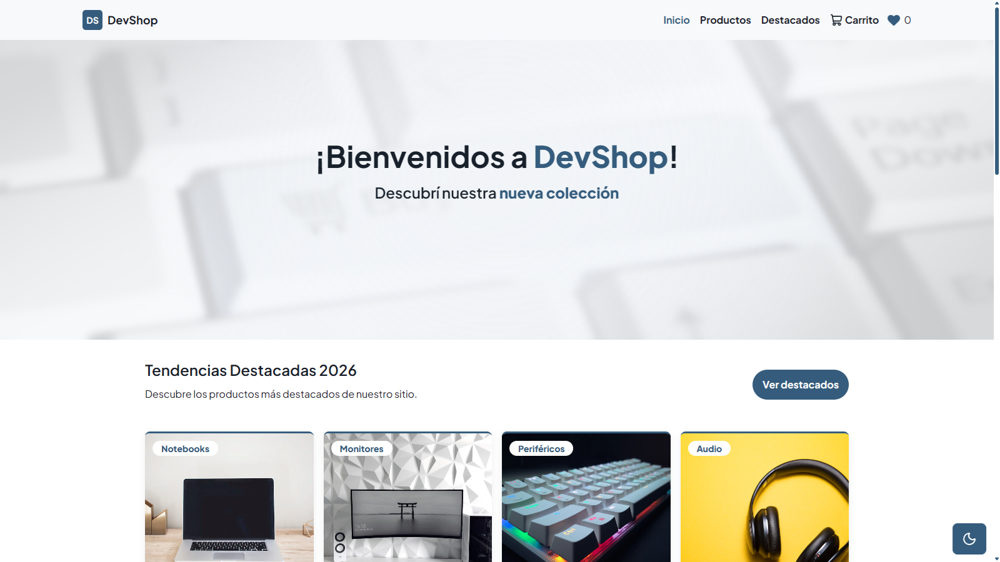

# Curso React - DevShop

Para el curso de ReactJS y este es el proyecto donde practico. Es una tienda ficticia en mi caso llamada DevShop, hecha con Vite.

La idea es ir aplicando lo que veo en clase: componentes, props, estado, efectos, formularios, Context, etc.

## Sobre el proyecto

Es un e-commerce bien simple. Tiene rutas con React Router:

| Ruta | Qué muestra |
|------|-------------|
| `/` | Inicio con hero, destacados y catálogo |
| `/productos` | Catálogo completo |
| `/destacados` | Solo productos destacados |
| `/:categoria` | Catálogo filtrado por categoría |
| `/productos/:id` | Detalle de producto |
| `/carrito` | Carrito de compras |
| `/favoritos` | Productos marcados como favoritos |
| `/politicas` | Política de privacidad (con índice y tabla de datos) |
| `/admin/*` | Panel de gestión: productos, usuarios y cupones (CRUD) |
| `*` | Página 404 (`Error404`) |

Hay tres layouts públicos con `Outlet` (`Layout`, `LayoutWithHero` con hero solo en el inicio, y `LayoutSimple` para páginas como políticas), más el `Dashboard` con lateral para el panel `/admin`.

Los productos y el equipo salen de **Firebase Firestore** (colecciones `products` y `team`). Cada producto tiene `excerpt` (texto corto para la card) y `description` (texto largo para el detalle). Las imágenes de los productos se suben a [ImgBB](https://imgbb.com/) desde el formulario de alta.

Además tiene:

- **Favoritos** guardados en localStorage, sincronizados entre componentes con el evento custom `local-storage-update`.
- **Contador de stock** en cada producto (`useCounter` respeta el stock máximo).
- **Carrito de compras** con Context (`CartContext` + `useCart`): agregar, quitar, sumar/restar cantidad, total y vaciar.
- **Catálogo centralizado** con `ProductsContext` + `useProductos`, así el fetch de productos se hace una sola vez en el provider y no en cada componente.
- **Textos de la UI centralizados** en `src/components/Configuracion.jsx` (títulos, secciones, links).
- **Precios formateados** con `Intl.NumberFormat` en `es-AR` / ARS (`src/utils/CompactNumber.jsx`).
- **Imágenes con placeholder y fallback** (`src/components/ui/Image.jsx`): mientras carga la foto real se muestra el logo precargado (sin caja gris ni saltos de layout); si falla, el logo queda como imagen final. El hook interno `useReadySrc` precarga en segundo plano respetando `srcSet`/`sizes`.
- **Panel admin** en `/admin` con CRUD de productos, usuarios y cupones (formularios con validación en `src/schemas/`).

## Tecnologías

- React 19
- React Router 8 (paquete `react-router`)
- Vite 8
- Firebase 12 (Firestore)
- ESLint 10
- SCSS con sistema propio de utilidades (`index.scss` + `components.scss`) y design tokens en `tokens.css`
- Lucide Icons
- ImgBB para subir las imágenes del formulario

## Lo que estoy practicando

- Componentes funcionales y pasar props
- useState y useEffect
- Hooks propios como useFetch, useFirestoreQuery, useFirestoreDoc, useFirestoreLive, useUpload, useCounter, useFavorito, useCart y useProductos
- Formularios controlados
- React Router: rutas, layouts con Outlet, rutas dinámicas con useParams y 404 con `path="*"`
- Context para el carrito y para el catálogo (provider + hook propio, con validación si se usa fuera del provider)
- Fetch con estados de carga y error, y protección contra updates desactualizados
- Render condicional y listas con map
- Guardar favoritos en localStorage y sincronizarlos entre componentes con eventos
- Reutilizar componentes chiquitos de UI (botones, alertas, precios, badges, etc)
- Design tokens en CSS y sistema propio de utilidades generado con SCSS (bucles `@each` sobre mapas: espaciados, gaps, redondeados, breakpoints)

## Datos con Firebase Firestore

Los productos y el equipo viven en Firestore. El acceso está centralizado en `src/services/firestore.service.js` (consultas: `findMany`, `findOne`, `buildQuery`, `mapSnapshot`) con tres hooks en `src/hooks/useFirestore.jsx`, todos con estado `{ data, loading, error }`:

```js
useFirestoreQuery('products', options)  // consulta puntual (filtros, orden, límite)
useFirestoreDoc('products', id)         // un documento por id
useFirestoreLive('products', options)   // suscripción en tiempo real con onSnapshot
```

La subida de imágenes del formulario está en `src/hooks/useUpload.jsx` (ImgBB, con loading/error propios).

## Estructura del proyecto

```
src/
  assets/        fuentes (Plus Jakarta Sans) e imágenes propias
  components/    Configuracion.jsx + ui (Badge, Button, Table, Modal, Image, Form, Inputs, ...)
  context/       CartContext (carrito), ProductsContext (catálogo)
  firebase/      config (initializeApp + Firestore)
  hooks/         useCart, useCounter, useFavorito, useFetch, useFirestore, useProductos, useUpload
  layout/        Layout (público: simple / con hero), Dashboard (admin) + global/ y dashboard/
  pages/         public/ (Home/, Producto/, Cart, Favoritos, Politicas), admin/ (productos, usuarios, cupones), global/Error404
  routes/        WebRoutes (pública), GestionRoutes (/admin), AuthRoutes (/auth)
  schemas/       validación de formularios (productos, usuarios, cupones)
  services/      firestore.service.js (acceso a datos)
  styles/        tokens.css (design tokens), index.scss (utilidades), components.scss (componentes)
  utils/         CompactNumber (precios), Avatar, Analytics, Storage, Validate, ...
  App.jsx        importa los tres archivos de estilos y monta las rutas
  main.jsx       BrowserRouter + CartProvider + ProductsProvider
public/
  images/        logos y avatares
  data/          datos estáticos (cupones.json)
  llms.txt       resumen del proyecto para IAs
```

Uso alias con `@` para importar más cómodo: `@assets`, `@components`, `@context`, `@hooks`, `@layout`, `@pages`, `@routes`, `@services`, `@schemas`, `@styles`, `@utils`, más `@ui`, `@dashboard`, `@public` y `@fireconfig`. Están configurados en el `vite.config.js`.

Un detalle: como el proyecto usa `"type": "module"`, en el `vite.config.js` no existe `__dirname` y hay que armarlo a mano con esto:

```js
import { fileURLToPath } from 'url'
import path from 'path'

const __dirname = path.dirname(fileURLToPath(import.meta.url))
```

Esto no es de React, es de Node. Lo saqué de **[Aliasing paths in Vite projects w/ TypeScript](https://dev.to/tilly/aliasing-in-vite-w-typescript-1lfo)** (uno de los comentarios)

## Para correrlo

Necesitás tener Node instalado.

```bash
pnpm install
pnpm dev
```

Después abrís http://localhost:5173

Otros comandos:

```bash
pnpm lint
pnpm build
pnpm preview
```

## Deploy (no olvidar el fallback SPA)

Como se usa `BrowserRouter`, el servidor debe devolver `index.html` en cualquier ruta. Sin esto, recargar o entrar directo a `/producto/1234` da **Page Not Found**:

- **Vercel:** `vercel.json` con `rewrites` de `/(.*)` a `/index.html` (más una excepción para `robots.txt`, `sitemap.xml` y `favicon.ico`).
- **Netlify:** `public/_redirects` con `/* /index.html 200` (Vite lo copia a `dist` en el build).

Cada plataforma lee solo su archivo, pueden convivir.

## Variables de entorno

El formulario sube la imagen a [ImgBB](https://imgbb.com/), así que hace falta una API key. Y como los datos ahora viven en **Firebase Firestore**, también hacen falta las credenciales del proyecto.

Crear un `.env` en la raíz con:

```
VITE_API_KEY=tu_clave
VITE_FIREBASE_API_KEY=...
VITE_FIREBASE_AUTH_DOMAIN=...
VITE_FIREBASE_PROJECT_ID=...
VITE_FIREBASE_STORAGE_BUCKET=...
VITE_FIREBASE_MESSAGING_SENDER_ID=...
VITE_FIREBASE_APP_ID=...
VITE_FIREBASE_MEASUREMENT_ID=...
```

La API key de ImgBB la conseguís gratis en [api.imgbb.com](https://api.imgbb.com/). Las de Firebase están en la consola de tu proyecto (Project settings → General → Your apps). Después de crear el `.env` hay que reiniciar el dev server.

### Temas y colores

El proyecto utiliza un sistema de **design tokens CSS** basado en variables personalizadas (`tokens.css`) para controlar colores, superficies, texto, bordes, estados y otros valores visuales.

Actualmente soporta:
* **Tema claro (`light`)**
* **Tema oscuro (`dark`)**
* Varias paletas de color:

  * `default`
  * `orange`
  * `material-dark`
  * `midnight`
  * `nordic`

El sistema está preparado para que posteriormente el cambio de color pueda controlarse mediante acciones de usuario, como un selector, botón o menú de configuración.


Vista previa:

